# SecKit: Building a Spring Boot 4 Microservice with Spec Kit
### *An Educational Walkthrough of Specification-Driven Development (SDD) & Clean Architecture*

[](https://openjdk.org/)
[](https://spring.io/projects/spring-boot)
[](.specify/memory/constitution.md)
[](.specify/)
[](target/surefire-reports/)

---

## Table of Contents

1. [Introduction to Specification-Driven Development (SDD)](#1-introduction-to-specification-driven-development-sdd)
2. [The Spec Kit Lifecycle at a Glance](#2-the-spec-kit-lifecycle-at-a-glance)
3. [Chronological Educational Walkthrough](#3-chronological-educational-walkthrough)
   - [Phase 0: Project Governance & Architecture Constitution](#phase-0-project-governance--architecture-constitution)
   - [Phase 1: Feature Inception & Sequential Branching](#phase-1-feature-inception--sequential-branching)
   - [Phase 2: Proactive Clarification](#phase-2-proactive-clarification)
   - [Phase 3: Architectural Planning & Design Artifacts](#phase-3-architectural-planning--design-artifacts)
   - [Phase 4: Quality Gate Checklists](#phase-4-quality-gate-checklists)
   - [Phase 5: Task Decomposition & Dependency Graph](#phase-5-task-decomposition--dependency-graph)
   - [Phase 6: Cross-Artifact Consistency Analysis](#phase-6-cross-artifact-consistency-analysis)
   - [Phase 7: GitHub Project Management & Issues Synchronization](#phase-7-github-project-management--issues-synchronization)
   - [Phase 8: Test-Driven Clean Architecture Implementation](#phase-8-test-driven-clean-architecture-implementation)
   - [Phase 9: Polish, Observability & Full Suite Verification](#phase-9-polish-observability--full-suite-verification)
4. [Key Architectural Patterns & Technical Decisions](#4-key-architectural-patterns--technical-decisions)
5. [Real-World Gotchas & Lessons Learned](#5-real-world-gotchas--lessons-learned)
6. [Reproducing the Project (Build, Test, Run)](#6-reproducing-the-project-build-test-run)
7. [Spec Kit Command Reference](#7-spec-kit-command-reference)

---

## 1. Introduction to Specification-Driven Development (SDD)

When building software with AI pairing assistants, standard prompt-and-code workflows often result in architectural drift, missing requirements, untracked tech debt, and unverified edge cases.

**Specification-Driven Development (SDD)** with **Spec Kit** solves this by establishing an immutable, verifiable chain of custody:

$$\text{Constitution} \longrightarrow \text{Specification} \longrightarrow \text{Clarification} \longrightarrow \text{Architecture Plan} \longrightarrow \text{Tasks} \longrightarrow \text{GitHub Issues} \longrightarrow \text{TDD Implementation}$$

Every line of production code in this repository was driven by an explicit task, designed against an architectural contract, and validated by automated tests before being marked complete.

---

## 2. The Spec Kit Lifecycle at a Glance

The diagram below illustrates the exact sequence of actions taken to build this project from scratch:

```mermaid
flowchart TD
    subgraph Governance ["Phase 0: Project Governance"]
        Init["speckit.git.initialize<br/>(Git init & baseline commit)"] --> Const["/speckit-constitution<br/>(Architectural laws in constitution.md)"]
    end

    subgraph Inception ["Phase 1: Feature Inception"]
        Const --> Branch["speckit.git.feature<br/>(Create branch 001-user-registration)"]
        Branch --> Spec["/speckit-specify<br/>(Requirements & user stories in spec.md)"]
        Spec --> Clarify["/speckit-clarify<br/>(Interactive Q&A to eliminate ambiguity)"]
    end

    subgraph Planning ["Phase 2: Planning & Design"]
        Clarify --> Plan["/speckit-plan<br/>(plan.md, data-model.md, contracts)"]
        Plan --> Checklists["/speckit-checklist<br/>(Quality gates in checklists/)"]
    end

    subgraph Breakdown ["Phase 3: Tasking & GitHub Sync"]
        Checklists --> Tasks["/speckit-tasks<br/>(Dependency-ordered tasks.md)"]
        Tasks --> Analyze["/speckit-analyze<br/>(Cross-artifact consistency verification)"]
        Analyze --> Remote["speckit.git.remote<br/>(Detect GitHub repository URL)"]
        Remote --> Issues["/speckit-taskstoissues<br/>(Convert tasks to GitHub Milestone & Issues)"]
    end

    subgraph Execution ["Phase 4: TDD Implementation"]
        Issues --> Impl["/speckit-implement<br/>(TDD execution: tests -> models -> infra -> web)"]
        Impl --> Verify["./mvnw clean verify<br/>(50 unit, slice, and integration tests pass)"]
        Verify --> Commit["speckit.git.commit<br/>(Auto-commit feature changes)"]
    end

    style Governance fill:#eff6ff,stroke:#1d4ed8,stroke-width:2px
    style Inception fill:#fdf4ff,stroke:#a21caf,stroke-width:2px
    style Planning fill:#f0fdf4,stroke:#15803d,stroke-width:2px
    style Breakdown fill:#fffbeb,stroke:#b45309,stroke-width:2px
    style Execution fill:#faf5ff,stroke:#6b21a8,stroke-width:2px
```



---

## 3. Chronological Educational Walkthrough

### Phase 0: Project Governance & Architecture Constitution

Before writing any feature code or specifications, we established the permanent architectural constraints of the application.

#### Action 1: Git Repository Initialization
- **Command**: `speckit.git.initialize` (automated pre-hook)
- **Script**: `.specify/extensions/git/scripts/bash/initialize-repo.sh`
- **Result**: Initialized local Git repository, configured default branch, and created the baseline commit `"[Spec Kit] Initial commit"`.

#### Action 2: Authoring the Project Constitution
- **Command**: `/speckit-constitution`
- **Artifact**: [`.specify/memory/constitution.md`](.specify/memory/constitution.md)
- **Educational Takeaway**: The Constitution defines non-negotiable architectural rules that all subsequent plans must follow:
  1. **Clean Architecture Separation**: 4 concentric layers (Domain $\to$ Application $\to$ Infrastructure $\to$ Presentation).
  2. **Domain Isolation**: Domain models are pure Java (no Spring, Hibernate, or Jackson annotations).
  3. **Constructor Injection**: Zero field injection (`@Autowired` on private fields is forbidden).
  4. **No Lombok**: Explicit boilerplate (records, constructors, getters) for transparency and compile-time safety.
  5. **Testing Pyramid**: Domain unit tests must run in milliseconds without Spring Context; slice tests (`@WebMvcTest`, `@DataJpaTest`) test adapters in isolation; `@SpringBootTest` tests end-to-end integration.

---

### Phase 1: Feature Inception & Sequential Branching

#### Action 1: Feature Branch Creation
- **Command**: `speckit.git.feature`
- **Script**: `.specify/extensions/git/scripts/bash/create-new-feature.sh`
- **Result**: Automatically calculated the next sequential prefix and created branch `001-user-registration`.

> [!NOTE]
> Spec Kit supports two branch numbering strategies configured in `.specify/extensions/git/git-config.yml`:
> - `sequential`: `001-feature-name`, `002-feature-name` (ideal for structured microservices).
> - `timestamp`: `20261019-143000-feature-name` (ideal for multi-developer teams).

#### Action 2: Feature Specification
- **Command**: `/speckit-specify`
- **Artifact**: [`specs/001-user-registration/spec.md`](specs/001-user-registration/spec.md)
- **Educational Takeaway**: Defines *what* the visitor needs without prematurely committing to technical implementations:
  - User Story 1 (P1): Account creation with full name, email, and password.
  - Validation rules: Name max 100 characters, email RFC 5322 compliance with lowercase normalization, password 8–128 characters.
  - Post/Redirect/Get (PRG) pattern redirecting to `/login` upon success.
  - Wiping password fields on validation failure while retaining name and email.

---

### Phase 2: Proactive Clarification

#### Action: Ambiguity Clarification
- **Command**: `/speckit-clarify`
- **Artifact**: Updated [`specs/001-user-registration/spec.md`](specs/001-user-registration/spec.md)
- **Educational Takeaway**: Identifies edge cases before engineering begins:
  - *How should email uniqueness be checked?* $\to$ Case-insensitively, trimmed, and normalized to lowercase at both application and database levels.
  - *What password hashing scheme is required?* $\to$ Spring Security's `BCryptPasswordEncoder` with cost factor 12.
  - *How do we prevent brute force / DoS?* $\to$ Rate limiting registration attempts to 5 requests per minute per IP returning HTTP 429.

---

### Phase 3: Architectural Planning & Design Artifacts

#### Action: Generating the Implementation Plan
- **Command**: `/speckit-plan`
- **Artifacts Generated**:
  - [`specs/001-user-registration/plan.md`](specs/001-user-registration/plan.md): Complete architecture document mapping layers, dependencies, and packaging.
  - [`specs/001-user-registration/research.md`](specs/001-user-registration/research.md): Evaluation of architectural choices (e.g., BCrypt vs Argon2, In-memory rate limiting vs Redis).
  - [`specs/001-user-registration/data-model.md`](specs/001-user-registration/data-model.md): Schema design for the `users` table and domain entity mappings.
  - [`specs/001-user-registration/contracts/registration-form.md`](specs/001-user-registration/contracts/registration-form.md): Form binding and HTTP status codes.
  - [`specs/001-user-registration/quickstart.md`](specs/001-user-registration/quickstart.md): Step-by-step verification guide.

---

### Phase 4: Quality Gate Checklists

#### Action: Generating Verification Checklists
- **Command**: `/speckit-checklist`
- **Artifacts**:
  - [`specs/001-user-registration/checklists/requirements.md`](specs/001-user-registration/checklists/requirements.md) (16 criteria)
  - [`specs/001-user-registration/checklists/registration.md`](specs/001-user-registration/checklists/registration.md) (31 criteria)
- **Educational Takeaway**: The implementation command (`/speckit-implement`) enforces these checklists as a pre-execution barrier: if any checkbox is incomplete, execution halts until resolved.

---

### Phase 5: Task Decomposition & Dependency Graph

#### Action: Generating Actionable Tasks
- **Command**: `/speckit-tasks`
- **Artifact**: [`specs/001-user-registration/tasks.md`](specs/001-user-registration/tasks.md)
- **Educational Takeaway**: 37 granular tasks categorized across 4 phases:
  - **Phase 1: Setup (`T001`–`T003`)**: Dependencies, `application.yml`, package scaffolding.
  - **Phase 2: Foundational (`T004`–`T012`)**: Flyway migration, security configuration, ports, rate limiter, login stub.
  - **Phase 3: User Story 1 (`T013`–`T033`)**:
    - *Tests First (TDD)*: `T013`–`T017`
    - *Domain & Application*: `T018`–`T026`
    - *Infrastructure Adapters*: `T027`–`T029`
    - *Presentation (Web MVC & Thymeleaf)*: `T030`–`T032`
    - *End-to-End Integration*: `T033`
  - **Phase 4: Polish & Observability (`T034`–`T037`)**: Actuator metrics, logging audit, clean verify.

Each task includes exact file paths, explicit dependencies, and parallel execution markers `[P]`.

---

### Phase 6: Cross-Artifact Consistency Analysis

#### Action: Non-Destructive Analysis
- **Command**: `/speckit-analyze`
- **Educational Takeaway**: Spec Kit verified consistency between `spec.md`, `plan.md`, and `tasks.md`:
  - Verified 100% of user story requirements mapped to one or more implementation tasks.
  - Verified no orphaned tasks existed without a specification reference.
  - Verified that all tasks flagged as `[P]` operate on disjoint files.

---

### Phase 7: GitHub Project Management & Issues Synchronization

#### Action 1: Remote Detection
- **Command**: `speckit.git.remote`
- **Result**: Extracted `ansgohar/seckit_JavaSpringProject` from `git config --get remote.origin.url`.

#### Action 2: Tasks to Issues Conversion
- **Command**: `/speckit-taskstoissues`
- **Result**:
  - Created GitHub Milestone: `001-user-registration`.
  - Created 37 tracked GitHub issues (`#9` to `#45`) corresponding to `T001` through `T037`.
  - Added labels: `setup`, `foundational`, `user-story`, `testing`, `polish`.

---

### Phase 8: Test-Driven Clean Architecture Implementation

#### Action: Executing the Implementation
- **Command**: `/speckit-implement`

Here is how each layer was constructed in strict TDD order:

#### 1. Domain Layer (`domain/`) — Pure Java Invariants
- Written first with unit tests ([`EmailTest`](src/test/java/com/gohar/platform/seckit/unit/domain/EmailTest.java), [`UserTest`](src/test/java/com/gohar/platform/seckit/unit/domain/UserTest.java)) executing in **0.04 seconds** without Spring.
- **Value Objects**:
  - [`UserId`](src/main/java/com/gohar/platform/seckit/domain/model/UserId.java): Encapsulates `java.util.UUID`.
  - [`Email`](src/main/java/com/gohar/platform/seckit/domain/model/Email.java): Strips whitespace, normalizes to lowercase, and validates RFC 5322 regex.
  - [`HashedPassword`](src/main/java/com/gohar/platform/seckit/domain/model/HashedPassword.java): Ensures only valid BCrypt hashes are held in domain memory.
- **Aggregate Root**:
  - [`User`](src/main/java/com/gohar/platform/seckit/domain/model/User.java): Factory method `User.create(...)` enforces invariants (name $\le$ 100 chars, active status).

#### 2. Application Layer (`application/`) — Use Cases & Ports
- Tested in isolation with Mockito ([`RegisterUserUseCaseTest`](src/test/java/com/gohar/platform/seckit/unit/application/RegisterUserUseCaseTest.java)).
- **Outbound Ports**:
  - [`UserRepositoryPort`](src/main/java/com/gohar/platform/seckit/application/ports/UserRepositoryPort.java)
  - [`PasswordEncoderPort`](src/main/java/com/gohar/platform/seckit/application/ports/PasswordEncoderPort.java)
- **Use Case Interactor**:
  - [`RegisterUserUseCase`](src/main/java/com/gohar/platform/seckit/application/usecases/RegisterUserUseCase.java): Exposes a single public method `execute(RegisterUserCommand command)`. Coordinates uniqueness check, password encoding, domain creation, and persistence.

#### 3. Infrastructure Layer (`infrastructure/`) — Adapters & Configuration
- **Persistence**:
  - Flyway migration [`V1__create_users_table.sql`](src/main/resources/db/migration/V1__create_users_table.sql) with unique index on `LOWER(email)`.
  - JPA Entity [`UserJpaEntity`](src/main/java/com/gohar/platform/seckit/infrastructure/persistence/UserJpaEntity.java).
  - Adapter [`UserRepositoryAdapter`](src/main/java/com/gohar/platform/seckit/infrastructure/persistence/UserRepositoryAdapter.java) maps between Domain and JPA representations.
  - Slice tested via [`SpringDataUserRepositoryTest`](src/test/java/com/gohar/platform/seckit/slice/infrastructure/SpringDataUserRepositoryTest.java) with PostgreSQL dialect compatibility.
- **Security & Rate Limiting**:
  - [`BCryptPasswordEncoderAdapter`](src/main/java/com/gohar/platform/seckit/infrastructure/security/BCryptPasswordEncoderAdapter.java): Implements `PasswordEncoderPort` using BCrypt cost factor 12.
  - [`RegistrationRateLimitFilter`](src/main/java/com/gohar/platform/seckit/infrastructure/ratelimit/RegistrationRateLimitFilter.java): In-memory sliding window rate limiter permitting 5 registration attempts per client IP per minute, returning HTTP 429 (`Too Many Requests`) with a `Retry-After: 60` header.

#### 4. Presentation Layer (`presentation/`) — Web MVC & SSR
- Tested via `@WebMvcTest` ([`RegistrationControllerTest`](src/test/java/com/gohar/platform/seckit/slice/presentation/RegistrationControllerTest.java)).
- **Form Object**:
  - [`RegistrationForm`](src/main/java/com/gohar/platform/seckit/presentation/form/RegistrationForm.java): Jakarta Bean Validation annotations (`@NotBlank`, `@Size`, `@Email`) and a dedicated `clearPassword()` method.
- **Controller**:
  - [`RegistrationController`](src/main/java/com/gohar/platform/seckit/presentation/controller/RegistrationController.java): Implements Post/Redirect/Get (PRG), adds flash messages via `RedirectAttributes`, and wipes sensitive password fields before redisplaying forms on validation failure.
- **Views**:
  - [`register.html`](src/main/resources/templates/register.html) & [`login.html`](src/main/resources/templates/login.html) with responsive CSS styling in [`styles.css`](src/main/resources/static/css/styles.css).

#### 5. End-to-End Integration Verification
- [`UserRegistrationIntegrationTest`](src/test/java/com/gohar/platform/seckit/integration/UserRegistrationIntegrationTest.java): Uses `@SpringBootTest` to assert full end-to-end user registration, database persistence, BCrypt hash verification, duplicate email rejection, and rate limit exhaustion.

---

### Phase 9: Polish, Observability & Full Suite Verification

1. **Actuator Health & Metrics**: Exposes `/actuator/health`, `/actuator/metrics`, and `/actuator/prometheus`.
2. **Log Audit**: Verified `RegistrationController` and `RegisterUserUseCase` log only non-sensitive identifiers (UUIDs, normalized email) and never plain-text passwords or hashes.
3. **Task Completion**: All 37 checkboxes in `tasks.md` updated to `[X]`.
4. **Final Verification**: `./mvnw clean verify` executes all 50 automated tests with `0 failures` and builds the repackaged production JAR.

---

## 4. Key Architectural Patterns & Technical Decisions

| Pattern / Invariant | Implementation in this Project | Why It Matters |
| :--- | :--- | :--- |
| **Clean Architecture Layering** | `domain` $\to$ `application` $\to$ `infrastructure` $\to$ `presentation` | Domain rules remain immune to database, UI, or framework changes. |
| **Port & Adapter (Hexagonal)** | `UserRepositoryPort` interface defined in application; `UserRepositoryAdapter` implemented in infrastructure. | Application use case depends on abstractions, never on JPA or Hibernate. |
| **Value Objects** | `UserId`, `Email`, `HashedPassword` | Self-validating immutable records eliminate primitive obsession. |
| **Post/Redirect/Get (PRG)** | `RegistrationController` returns `redirect:/login` after POST. | Prevents duplicate form submissions on page refresh. |
| **Credential Protection** | `RegistrationForm.clearPassword()` called on every validation failure. | Passwords never round-trip back to the browser in error states. |
| **Defense in Depth** | Uniqueness checked in `RegisterUserUseCase` AND via PostgreSQL index `LOWER(email)`. | Guarantees data integrity even under concurrent race conditions. |
| **No Lombok** | Explicit Java 25 records and constructors. | Clean compile-time transparency; zero annotation-processing issues. |

---

## 5. Real-World Gotchas & Lessons Learned

During the execution of this project, several cutting-edge technical challenges were solved:

### 1. Spring Boot 4 Modular Testing Dependencies
- **Gotcha**: Spring Boot 4 modularized test starters. `@MockBean` is deprecated/removed in favor of Spring Framework 6.2's `@MockitoBean`.
- **Solution**: Replaced `@MockBean` with `org.springframework.test.context.bean.override.mockito.MockitoBean`. Added `spring-boot-starter-data-jpa-test` and `spring-boot-starter-webmvc-test` to `pom.xml`.

### 2. H2 PostgreSQL Mode Compatibility
- **Gotcha**: In newer H2 versions (v2.5+), older connection parameters like `DEFAULT_NULL_UNTYPED=TRUE` cause database initialization failures.
- **Solution**: Configured test datasource URL as:
  ```properties
  jdbc:h2:mem:testdb;MODE=PostgreSQL;DATABASE_TO_LOWER=TRUE
  ```
  with `hibernate.dialect=H2Dialect` and `ddl-auto=create-drop` for test slices.

### 3. Thymeleaf `#fields` Scope Invariant
- **Gotcha**: Placing `#fields.hasGlobalErrors()` outside the `<form th:object="${registrationForm}">` tag throws `TemplateProcessingException`.
- **Solution**: Scoped all `#fields` checks strictly inside the parent `<form>` element.

---

## 6. Reproducing the Project (Build, Test, Run)

### Prerequisites
- **Java**: JDK 25 installed (`java -version`)
- **Maven**: Bundled Maven wrapper (`./mvnw`)

### 1. Run the Automated Test Suite (50 Tests)
```bash
./mvnw clean verify
```
```text
[INFO] Results:
[INFO] Tests run: 50, Failures: 0, Errors: 0, Skipped: 0
[INFO] ------------------------------------------------------------------------
[INFO] BUILD SUCCESS
```

### 2. Launch the Application Locally
```bash
./mvnw spring-boot:run
```

### 3. Verification URLs
- **Registration Form**: [http://localhost:8080/register](http://localhost:8080/register)
- **Login Landing Page**: [http://localhost:8080/login](http://localhost:8080/login)
- **Actuator Health Check**: [http://localhost:8080/actuator/health](http://localhost:8080/actuator/health)

---

## 7. Spec Kit Command Reference

| Command | Action Performed | Key Output Artifacts |
| :--- | :--- | :--- |
| `speckit.git.initialize` | Git repository initialization & baseline commit | Git history |
| `/speckit-constitution` | Establish permanent architectural rules | [`.specify/memory/constitution.md`](.specify/memory/constitution.md) |
| `speckit.git.feature` | Create sequential or timestamped feature branch | Git branch `001-user-registration` |
| `/speckit-specify` | Capture requirements and user stories | [`specs/001-user-registration/spec.md`](specs/001-user-registration/spec.md) |
| `/speckit-clarify` | Interactive Q&A to resolve underspecified logic | Updated `spec.md` |
| `/speckit-plan` | Architecture plan, data model & contracts | [`plan.md`](specs/001-user-registration/plan.md), [`data-model.md`](specs/001-user-registration/data-model.md) |
| `/speckit-checklist` | Create quality gate checklists | [`checklists/requirements.md`](specs/001-user-registration/checklists/requirements.md) |
| `/speckit-tasks` | Decompose plan into ordered tasks | [`specs/001-user-registration/tasks.md`](specs/001-user-registration/tasks.md) |
| `/speckit-analyze` | Cross-artifact consistency & coverage check | Consistency report |
| `speckit.git.remote` | Detect GitHub repository remote URL | Parsed owner & repo |
| `/speckit-taskstoissues` | Sync tasks to GitHub Milestone & Issues | GitHub Milestone & Issues `#9`–`#45` |
| `/speckit-implement` | Execute TDD implementation across all layers | Source code, tests, updated `tasks.md` |
| `speckit.git.commit` | Auto-commit changes after lifecycle steps | Clean Git commit log |