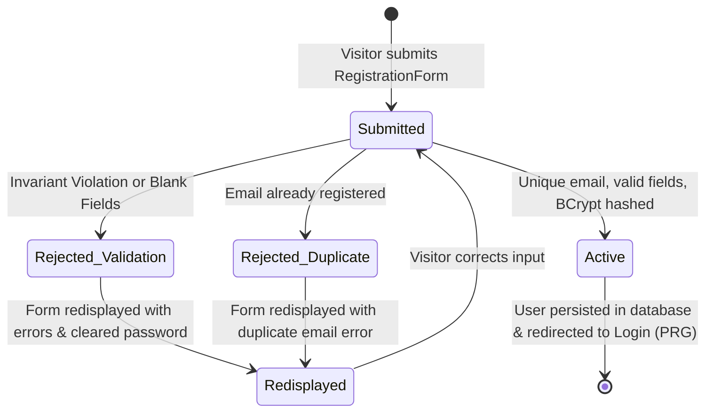

# Data Model: User Registration

**Feature**: User Registration  
**Date**: 2026-10-19  
**Status**: Ready  
**Specs Directory**: `specs/001-user-registration`

---

## 1. Domain Layer Models (Clean Architecture Core)

The Domain layer contains pure Java business models with zero dependencies on frameworks, databases, or annotations.

### `User` (Aggregate Root)
Represents a registered user entity within the application's domain.

| Field | Type | Invariant Rules / Constraints |
| :--- | :--- | :--- |
| `id` | `UserId` | Immutable unique identifier (UUID). |
| `name` | `String` | Not null, not blank, length ≤ 100 chars. |
| `email` | `Email` | Immutable Value Object; normalized and valid. |
| `passwordHash` | `HashedPassword` | Immutable Value Object containing BCrypt hash string. |
| `status` | `UserStatus` | Default `ACTIVE`. |
| `createdAt` | `Instant` | UTC timestamp of creation. |

### `Email` (Value Object)
Enforces email syntax, boundary limits, and case-insensitivity.
- **Normalization**: `rawEmail.trim().toLowerCase(Locale.ROOT)`
- **Format Validation**: Valid standard RFC 5322 compliant regex pattern (`^[A-Za-z0-9+_.-]+@(.+)$`).
- **Length Constraint**: Maximum 254 characters (RFC 5321).
- **Equality**: Structural equality based strictly on normalized string value.

### `HashedPassword` (Value Object)
Encapsulates a cryptographically secure password hash.
- **Validation**: Ensures hash matches valid BCrypt format (starts with `$2a$`, `$2b$`, or `$2y$`, length 60 characters).
- **Security Rule**: Does not expose plain text password; `toString()` masks hash representation.

### `UserStatus` (Domain Enum)
- `ACTIVE`: The user account is active and entitled to log in.

---

## 2. Application Layer Command & Result Objects

### `RegisterUserCommand` (Record)
```java
public record RegisterUserCommand(
    String name,
    String email,
    String rawPassword
) {}
```

### `RegisterUserResult` (Record)
```java
public record RegisterUserResult(
    UUID userId,
    String name,
    String email,
    Instant createdAt
) {}
```

---

## 3. Presentation Layer Form Model

### `RegistrationForm` (Form Backing Bean)
Backing bean for Thymeleaf form binding in Spring MVC.

```java
public class RegistrationForm {
    @NotBlank(message = "Name is required")
    @Size(max = 100, message = "Name cannot exceed 100 characters")
    private String name;

    @NotBlank(message = "Email address is required")
    @Email(message = "Please enter a valid email address")
    @Size(max = 254, message = "Email address cannot exceed 254 characters")
    private String email;

    @NotBlank(message = "Password is required")
    @Size(min = 8, max = 128, message = "Password must be at least 8 characters")
    private String password;

    // Getters, Setters, and clearPassword() helper
}
```

---

## 4. Infrastructure Persistence Schema (PostgreSQL)

### Flyway Migration: `V1__create_users_table.sql`

```sql
CREATE TABLE users (
    id UUID PRIMARY KEY,
    name VARCHAR(100) NOT NULL,
    email VARCHAR(254) NOT NULL,
    password_hash VARCHAR(100) NOT NULL,
    status VARCHAR(20) NOT NULL DEFAULT 'ACTIVE',
    created_at TIMESTAMP WITH TIME ZONE NOT NULL DEFAULT NOW()
);

-- Unique constraint on lowercase email to guarantee uniqueness at database layer
CREATE UNIQUE INDEX idx_users_email_unique ON users (LOWER(email));
```

---

## 5. Entity State Lifecycle


