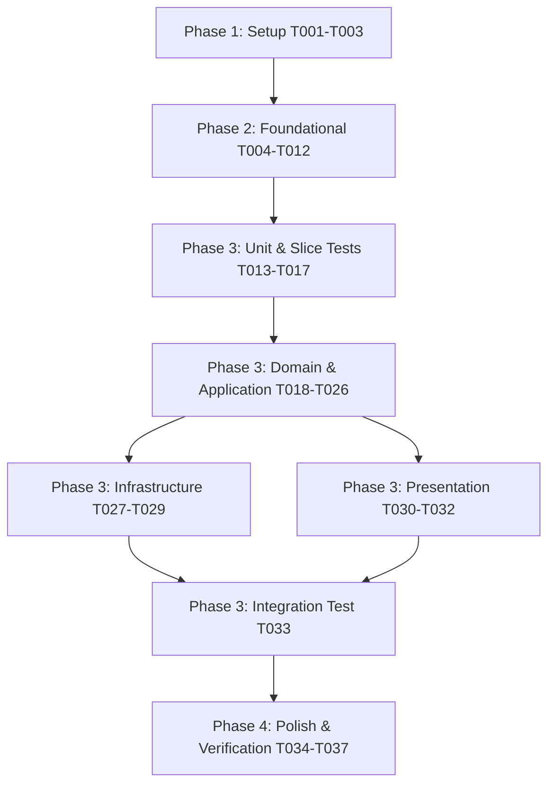

# Tasks: User Registration

**Input**: Design documents from `specs/001-user-registration/` (`spec.md`, `plan.md`, `research.md`, `data-model.md`, `contracts/registration-form.md`, `quickstart.md`)  
**Prerequisites**: `plan.md`, `spec.md`, `data-model.md`, `contracts/registration-form.md`  

**Tests**: MANDATORY per Constitution Principle IX. Every Domain model and Application use-case interactor MUST have fast unit tests running without Spring context. Presentation controllers and Infrastructure repositories must have slice and integration tests.

**Organization**: Tasks are grouped by phase and user story to enable independent implementation and testing of each story.

## Format: `[ID] [P?] [Story] Description`

- **[P]**: Can run in parallel (different files, no dependencies)
- **[Story]**: Which user story this task belongs to (e.g., [US1])
- Exact file paths are included in every task description

---

## Phase 1: Setup (Shared Infrastructure & Dependencies)

**Purpose**: Initialize project dependencies, configuration properties, and Clean Architecture directory layout.

- [X] T001 Add feature dependencies to `pom.xml` (`spring-boot-starter-thymeleaf`, `spring-boot-starter-validation`, `spring-boot-starter-security`, `spring-boot-starter-data-jpa`, `postgresql`, `flyway-core`, `flyway-database-postgresql`, and test database dependencies `h2` configured in PostgreSQL compatibility mode `MODE=PostgreSQL` or `testcontainers-postgresql`)
- [X] T002 [P] Configure Thymeleaf, Flyway, JPA, and Actuator properties in `src/main/resources/application.yml`
- [X] T003 [P] Create Clean Architecture package directory structure under `src/main/java/com/gohar/platform/seckit/` (`domain/model`, `domain/exception`, `application/usecases`, `application/command`, `application/result`, `application/ports`, `infrastructure/persistence`, `infrastructure/security`, `infrastructure/ratelimit`, `presentation/form`, `presentation/controller`)

---

## Phase 2: Foundational (Blocking Prerequisites for All User Stories)

**Purpose**: Core infrastructure, database migrations, security configurations, ports, and common templates that MUST be complete before user story logic can execute.

**⚠️ CRITICAL**: No user story implementation work can begin until this foundational phase is complete.

- [X] T004 Create Flyway migration script `V1__create_users_table.sql` in `src/main/resources/db/migration/` defining the `users` table and unique index on `LOWER(email)`
- [X] T005 [P] Define `UserRepositoryPort` interface in `src/main/java/com/gohar/platform/seckit/application/ports/UserRepositoryPort.java`
- [X] T006 [P] Define `PasswordEncoderPort` interface in `src/main/java/com/gohar/platform/seckit/application/ports/PasswordEncoderPort.java`
- [X] T007 [P] Implement `BCryptPasswordEncoderAdapter` in `src/main/java/com/gohar/platform/seckit/infrastructure/security/BCryptPasswordEncoderAdapter.java` implementing `PasswordEncoderPort` with BCrypt cost factor 12
- [X] T008 [P] Configure Spring Security in `src/main/java/com/gohar/platform/seckit/infrastructure/security/SecurityConfiguration.java` permitting unauthenticated access to `/register`, `/login`, `/actuator/**`, and static CSS resources
- [X] T009 [P] Implement `RegistrationRateLimitFilter` in `src/main/java/com/gohar/platform/seckit/infrastructure/ratelimit/RegistrationRateLimitFilter.java` with accompanying unit test in `src/test/java/com/gohar/platform/seckit/unit/infrastructure/RegistrationRateLimitFilterTest.java` enforcing 5 registration attempts per client IP per minute and asserting HTTP 429 response on subsequent requests
- [X] T010 Create base stylesheet `styles.css` in `src/main/resources/static/css/styles.css` for form layouts, input states, validation error highlights, and alert banners
- [X] T011 [P] Create login landing template `login.html` in `src/main/resources/templates/login.html` displaying success flash banner and login form stub
- [X] T012 [P] Implement `LoginController` in `src/main/java/com/gohar/platform/seckit/presentation/controller/LoginController.java` handling `GET /login`

**Checkpoint**: Foundation ready — database schema, ports, security baseline, and landing view ready for User Story 1.

---

## Phase 3: User Story 1 - Visitor Account Registration (Priority: P1) 🎯 MVP

**Goal**: Enable public visitors to register a new account by providing full name, email address, and password via a Thymeleaf web form. The system normalizes email to lowercase, validates inputs via Bean Validation, verifies email uniqueness at application and database layers, hashes passwords with BCrypt, preserves valid inputs while wiping passwords on failure, and redirects to `/login` via PRG on success.

**Independent Test**: Complete and submit the registration form at `/register` with valid credentials, then verify:
1. User account is persisted in `users` table with normalized lowercase email, `ACTIVE` status, and BCrypt password hash.
2. Browser receives `303 See Other` redirecting to `/login` with success flash message.
3. Submitting invalid inputs redisplays `/register` with field-specific error messages and an empty password field.
4. Submitting a duplicate email redisplays `/register` with `"This email address is already in use."`.

### Tests for User Story 1 (MANDATORY) ⚠️

> **NOTE: Write these tests FIRST, ensure they FAIL before implementation**

- [X] T013 [P] [US1] Unit test for `Email` value object in `src/test/java/com/gohar/platform/seckit/unit/domain/EmailTest.java` verifying lowercase normalization, whitespace trimming, regex validation, and length ≤ 254 characters
- [X] T014 [P] [US1] Unit test for `User` aggregate root in `src/test/java/com/gohar/platform/seckit/unit/domain/UserTest.java` verifying name length ≤ 100, password length 8..128, and default `ACTIVE` status
- [X] T015 [P] [US1] Unit test for `RegisterUserUseCase` in `src/test/java/com/gohar/platform/seckit/unit/application/RegisterUserUseCaseTest.java` using Mockito (no Spring context) verifying successful registration, duplicate email rejection (`DuplicateEmailException`), and port delegation
- [X] T016 [P] [US1] MVC slice test for `RegistrationController` in `src/test/java/com/gohar/platform/seckit/slice/presentation/RegistrationControllerTest.java` using `@WebMvcTest` verifying GET `/register` view, POST `/register` validation rejections, field error binding, password wiping, and PRG redirect to `/login`
- [X] T017 [P] [US1] Data JPA slice test for `SpringDataUserRepository` in `src/test/java/com/gohar/platform/seckit/slice/infrastructure/SpringDataUserRepositoryTest.java` using `@DataJpaTest` with PostgreSQL dialect compatibility (`MODE=PostgreSQL`) verifying entity mapping, case-insensitive `existsByEmail` queries, and unique index enforcement on `LOWER(email)`

### Domain & Application Implementation for User Story 1

- [X] T018 [P] [US1] Create `UserId` value object in `src/main/java/com/gohar/platform/seckit/domain/model/UserId.java` encapsulating UUID
- [X] T019 [P] [US1] Create `Email` value object in `src/main/java/com/gohar/platform/seckit/domain/model/Email.java` enforcing lowercase normalization, whitespace trimming, and RFC 5322 validation
- [X] T020 [P] [US1] Create `HashedPassword` value object in `src/main/java/com/gohar/platform/seckit/domain/model/HashedPassword.java` encapsulating validated BCrypt hash
- [X] T021 [P] [US1] Create `UserStatus` enum in `src/main/java/com/gohar/platform/seckit/domain/model/UserStatus.java` with `ACTIVE`
- [X] T022 [US1] Create `User` aggregate root entity in `src/main/java/com/gohar/platform/seckit/domain/model/User.java` (depends on T018, T019, T020, T021)
- [X] T023 [P] [US1] Create domain exceptions `DuplicateEmailException.java` and `DomainValidationException.java` in `src/main/java/com/gohar/platform/seckit/domain/exception/`
- [X] T024 [P] [US1] Create `RegisterUserCommand` record in `src/main/java/com/gohar/platform/seckit/application/command/RegisterUserCommand.java`
- [X] T025 [P] [US1] Create `RegisterUserResult` record in `src/main/java/com/gohar/platform/seckit/application/result/RegisterUserResult.java`
- [X] T026 [US1] Implement `RegisterUserUseCase` in `src/main/java/com/gohar/platform/seckit/application/usecases/RegisterUserUseCase.java` executing single public method `execute(...)` with application-level email uniqueness check and password hashing (depends on T022, T023, T024, T025, T005, T006)

### Infrastructure Implementation for User Story 1

- [X] T027 [P] [US1] Create `UserJpaEntity` in `src/main/java/com/gohar/platform/seckit/infrastructure/persistence/UserJpaEntity.java` mapped to `users` table
- [X] T028 [P] [US1] Create `SpringDataUserRepository` interface in `src/main/java/com/gohar/platform/seckit/infrastructure/persistence/SpringDataUserRepository.java` with `boolean existsByEmail(String email)`
- [X] T029 [US1] Implement `UserRepositoryAdapter` in `src/main/java/com/gohar/platform/seckit/infrastructure/persistence/UserRepositoryAdapter.java` implementing `UserRepositoryPort` and mapping between domain `User` and `UserJpaEntity` (depends on T027, T028)

### Presentation Implementation for User Story 1

- [X] T030 [P] [US1] Create `RegistrationForm` backing bean in `src/main/java/com/gohar/platform/seckit/presentation/form/RegistrationForm.java` with Jakarta Bean Validation annotations (`@NotBlank`, `@Size`, `@Email`) and `clearPassword()` helper
- [X] T031 [US1] Implement `RegistrationController` in `src/main/java/com/gohar/platform/seckit/presentation/controller/RegistrationController.java` handling `GET /register` and `POST /register`, binding `BindingResult`, clearing passwords on error, and returning `redirect:/login` with `RedirectAttributes` (depends on T026, T030)
- [X] T032 [US1] Create Thymeleaf registration template `register.html` in `src/main/resources/templates/register.html` rendering form fields for name, email, password, and contextual field errors using `th:errors` (depends on T010)

### End-to-End Integration Verification for User Story 1

- [X] T033 [US1] Implement end-to-end integration test `UserRegistrationIntegrationTest` in `src/test/java/com/gohar/platform/seckit/integration/UserRegistrationIntegrationTest.java` using `@SpringBootTest` and MockMvc with PostgreSQL test database parity verifying full form submission, DB persistence, BCrypt hash verification, duplicate email rejection, PRG flash message, and rate limit exhaustion returning HTTP 429 (depends on T026, T029, T031, T032)

**Checkpoint**: At this point, User Story 1 is fully functional, styled, verified, and testable end-to-end!

---

## Phase 4: Polish & Cross-Cutting Concerns

**Purpose**: System observability, security hardening, documentation validation, and full regression verification.

- [X] T034 [P] Verify Actuator health and Prometheus metrics endpoints in `src/main/resources/application.yml`
- [X] T035 [P] Audit structured logging in `RegistrationController` and `RegisterUserUseCase` ensuring passwords and sensitive credentials are never logged
- [X] T036 Execute manual verification walkthrough against running application per instructions in `specs/001-user-registration/quickstart.md`
- [X] T037 Run complete build and test suite (`./mvnw clean verify`) ensuring all unit, slice, and integration tests pass

---

## Dependencies & Execution Order

### Phase Dependencies



### Critical Path Dependencies

1. **Foundational Phase (Phase 2)** MUST be complete before User Story 1 implementation.
2. **Tests (T013–T017)** MUST be written first and verify failure before implementing corresponding classes.
3. **Domain Models (T018–T023)** MUST be created before Application Use Case (`RegisterUserUseCase` T026).
4. **Ports (T005, T006)** MUST exist before Use Case (`RegisterUserUseCase` T026) and Adapters (T007, T029).
5. **Form Backing Bean (T030)** and **Use Case (T026)** MUST exist before Controller (T031).
6. **Controller (T031)**, **Template (T032)**, and **Adapters (T029)** MUST be complete before Integration Test (T033).

---

## Parallel Execution Opportunities

### Phase 1 & 2 Parallel Tasks

```bash
# Setup:
Task: "T002 Configure application properties in src/main/resources/application.yml"
Task: "T003 Create Clean Architecture package directory structure"

# Foundational:
Task: "T005 Define UserRepositoryPort interface"
Task: "T006 Define PasswordEncoderPort interface"
Task: "T007 Implement BCryptPasswordEncoderAdapter"
Task: "T008 Configure Spring Security"
Task: "T009 Implement RegistrationRateLimitFilter with unit test"
Task: "T011 Create login landing template"
Task: "T012 Implement LoginController"
```

### Phase 3 Tests (Can all be authored in parallel)

```bash
Task: "T013 Unit test for Email value object"
Task: "T014 Unit test for User aggregate root"
Task: "T015 Unit test for RegisterUserUseCase"
Task: "T016 MVC slice test for RegistrationController"
Task: "T017 Data JPA slice test for SpringDataUserRepository with PostgreSQL dialect compatibility"
```

### Phase 3 Implementation Models & Commands (Can run in parallel)

```bash
Task: "T018 Create UserId value object"
Task: "T019 Create Email value object"
Task: "T020 Create HashedPassword value object"
Task: "T021 Create UserStatus enum"
Task: "T023 Create domain exceptions"
Task: "T024 Create RegisterUserCommand record"
Task: "T025 Create RegisterUserResult record"
Task: "T027 Create UserJpaEntity"
Task: "T028 Create SpringDataUserRepository interface"
Task: "T030 Create RegistrationForm backing bean"
```

---

## Implementation Strategy

### MVP First (User Story 1 Focus)

1. **Phase 1 (Setup)**: Add required Maven dependencies and package folders (T001–T003).
2. **Phase 2 (Foundation)**: Run Flyway migration `V1` and configure Spring Security, ports, and landing page (T004–T012).
3. **Phase 3 (TDD Tests)**: Write and run unit, slice, and repository tests; verify all tests fail as expected (T013–T017).
4. **Phase 3 (Core Domain & App)**: Implement `Email`, `User`, and `RegisterUserUseCase`; verify unit tests pass (T018–T026).
5. **Phase 3 (Persistence)**: Implement `UserJpaEntity` and `UserRepositoryAdapter`; verify JPA slice test passes (T027–T029).
6. **Phase 3 (Presentation & View)**: Implement `RegistrationForm`, `RegistrationController`, and `register.html`; verify MVC slice test passes (T030–T032).
7. **Phase 3 (Integration Verification)**: Execute `UserRegistrationIntegrationTest` and verify end-to-end flow passes (T033).
8. **Phase 4 (Polish)**: Verify rate limiting, logging security, and execute manual quickstart walkthrough (T034–T037).
